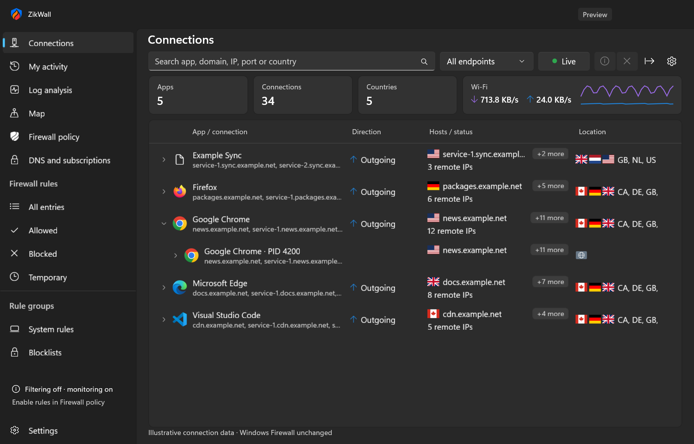
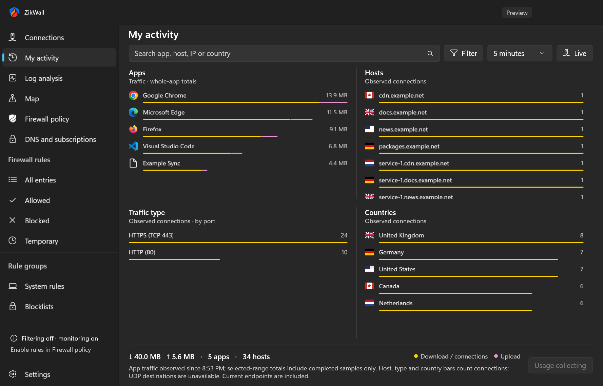
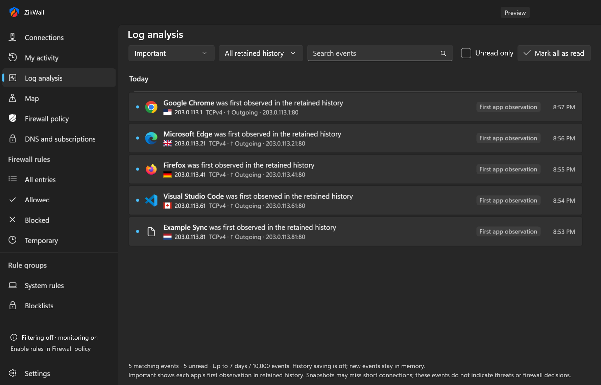
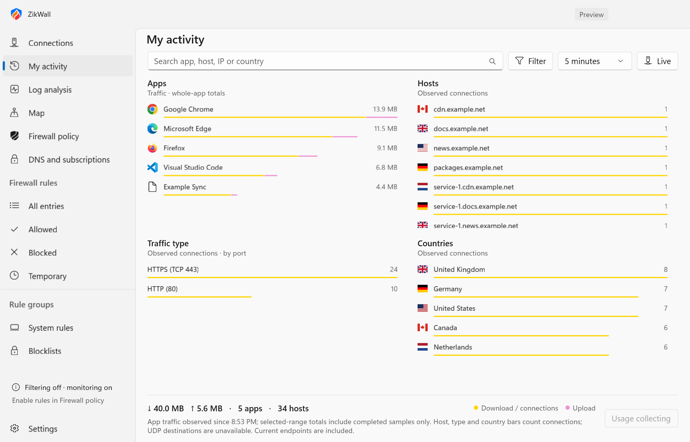
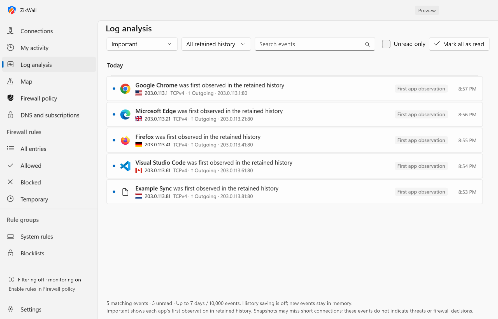
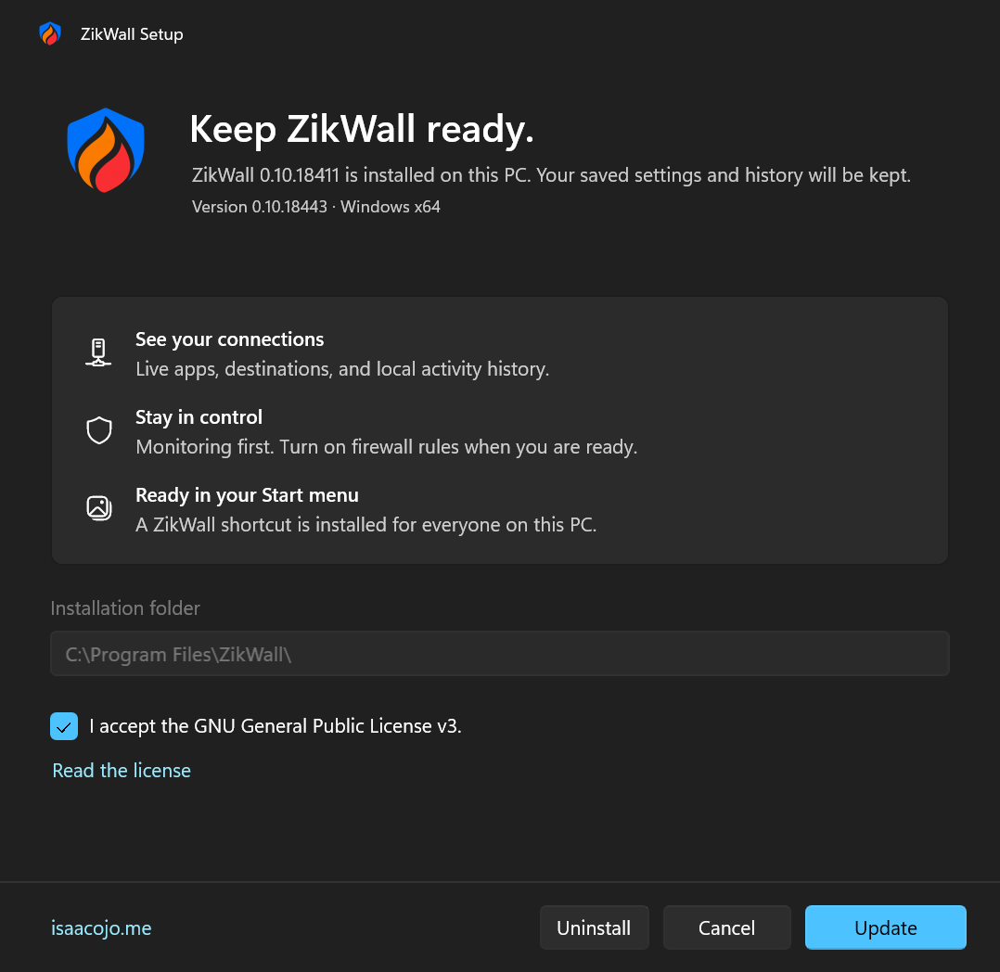

<div align="center">


# ZikWall

**Your network. In clear view.**

A native Windows connection monitor and firewall preview, built with WinUI 3.


[](LICENSE)

[Get started](#get-started) · [Screenshots](#screenshots) · [Documentation](#documentation) · [Report an issue](https://github.com/ElSierra/ZikWall/issues)

</div>

ZikWall shows which apps are connecting, where they connect, and how their activity changes. Explore live endpoints, review local history, and apply firewall policies when you choose.

ZikWall is an independently maintained **semi-fork of [simplewall](https://github.com/henrypp/simplewall) by Henry++**. It preserves the project's native source and attribution while developing a new WinUI 3 application and a separate Windows Filtering Platform (WFP) broker. It is not an official simplewall release or endorsed by its upstream maintainers. See [upstream notices and provenance](docs/UPSTREAM-NOTICES.md).

## Screenshots

Current native ZikWall UI, captured on 13 October 2026. Connection names, addresses, history, and traffic amounts below are illustrative sample data.



| My activity | Log analysis |
| --- | --- |
|  |  |
| App totals and host, traffic-type, and country breakdowns. | Searchable events with unread markers and time filters. |

<details>
<summary>Light theme and WinUI 3 setup</summary>






The native setup below shows an update from an older installed build. A fresh installation presents the install flow.



</details>

[How these screenshots are generated](docs/screenshots/README.md)

## What you can do

| | |
| --- | --- |
| **See live connections** | Expand apps into processes and endpoints. Search by app, domain hint, IP, port, or country; filter direction and scope. |
| **Understand activity** | View per-app observed traffic with the optional collector, plus connection counts by host, port, and country. Review first observations and retained events in Log analysis. |
| **Recognize destinations** | See offline country and network-owner hints, explore the map, and optionally enrich connections with DNS hints. |
| **Control connections** | Review app or endpoint blocks, save profiles and rules, set expiry times, and apply a session policy through the elevated WFP broker. |
| **Use DNS tools** | Configure an optional loopback DNS-over-HTTPS proxy, domain exceptions, and HTTPS list subscriptions. |
| **Keep it close** | Use the tray, optional sign-in startup, light/dark/system themes, CSV export, and opt-in Windows notifications with app icons. |
| **Install normally** | Use the WinUI 3 `setup.exe` or the MSI. Installation creates a ZikWall shortcut in Start menu Programs for all users. |

## Get started

**Windows 11 x64 is recommended.** The app's API minimum is Windows 10 version 2004 (build 19041); validation has focused on Windows 11 x64.

### Build the installer

Install the **.NET SDK 8 or newer**, **Visual Studio C++ build tools**, and the **Windows SDK**. Initial dependency restore requires an internet connection. Then:

```powershell
git clone https://github.com/ElSierra/ZikWall.git
cd ZikWall
.\build.bat
```

The build produces:

- **`artifacts\installer\setup.exe`** — native WinUI 3 install, update, repair, and removal interface, with the MSI and required runtime payload bundled.
- **`artifacts\installer\setup.msi`** — Windows Installer package for direct installation or deployment.

Open `setup.exe` and follow the wizard. Installation requests Windows elevation, and the installed app is available from **Start → All apps → ZikWall**. Open ZikWall to begin monitoring; filtering starts off. To enforce rules, configure **Firewall policy**, choose **Enable filtering**, and approve elevation.

GNU Make users can run `make setup`; `make install` opens the last verified setup. Rebuild after changing the source. See [installation and package verification](docs/INSTALLER.md).

### Run a portable development build

```powershell
.\tools\build-winui.ps1 -Launch
```

Keep the entire `artifacts\ZikWall` folder together. The executable depends on the accompanying runtime, broker, engine, and assets.

## Preview boundaries

- **Session firewall enforcement:** applied filters end when the app/broker session closes. Saved policy definitions remain, but enforcement does not persist across reboot. Windows Firewall settings are unchanged.
- **Observation is not packet capture:** polling can miss short connections. TCP endpoints are visible; UDP remote destinations are unavailable. First-observation events are not threat detections or firewall decisions.
- **Hints have limits:** country/network-owner data and DNS names aid interpretation. They do not prove the requested website, expose full URLs, or inspect encrypted traffic.
- **Traffic totals have scope:** adapter rates cover the adapter. Per-app usage is optional, requires elevation per session, and its native accuracy and collector-on resource use still need broader validation. Host, traffic-type, and country bars count connections rather than attributed bytes.
- **Enforcement coverage is still expanding:** scoped outbound IPv4 TCP checks have passed; broader protocol and lifecycle validation remains. Full simplewall or Little Snitch feature parity is not claimed.

See [monitoring behavior](docs/MONITORING.md), [usage limits](docs/MONITOR-AND-USAGE.md), and [broker validation](docs/WFP-BROKER.md) for the exact scope.

## Development

```powershell
make doctor   # Check local build tools
make dev      # Build and launch
make check    # Model/service tests and integrity checks
```

GNU Make is optional. The same commands are available through:

```powershell
powershell -NoProfile -ExecutionPolicy Bypass -File tools/tasks.ps1 -Task check
```

Native UI and elevated runtime diagnostics are separate from `make check`. See [all developer commands](docs/DEVELOPMENT.md) and [repeatable performance measurements](docs/PERFORMANCE.md).

| Directory | Purpose |
| --- | --- |
| `ui/ZikWall.WinUI` | Current C#/XAML desktop app, presentation, and monitoring models |
| `ui/ZikWall.Setup` | Native WinUI 3 setup interface |
| `engine` | Windows SDK filtering engine and elevated broker |
| `tools` | Build, packaging, verification, and asset tooling |
| `tests` | Model/service checks, engine checks, and benchmarks |
| `src` | Preserved legacy native source; not the supported WinUI build entry point |
| `docs` | Behavior, limits, validation, provenance, and screenshots |

The supported build does not fetch the legacy simplewall, routine, or builder repositories. The archived native solution has a dependency compatibility blocker; use the commands above for the current app.

## Documentation

- [App build and usage](ui/README.md)
- [Installer and Start menu integration](docs/INSTALLER.md)
- [Monitoring, notifications, and country hints](docs/MONITORING.md)
- [Activity, tray, startup, and observed usage](docs/MONITOR-AND-USAGE.md)
- [DNS and subscriptions](docs/DNS-SUBSCRIPTIONS.md)
- [WFP broker and enforcement boundaries](docs/WFP-BROKER.md)
- [Security review](docs/SECURITY-REVIEW.md)
- [Offline map data and attribution](docs/MAP-DATA.md)

## Contributing

Bug reports, focused fixes, and reproducible Windows testing are welcome. [Open an issue](https://github.com/ElSierra/ZikWall/issues) with the app version, Windows build, steps to reproduce, and expected behavior. Remove personal addresses, executable paths, and browsing history from shared logs or screenshots.

For code changes, explain the behavior being changed and the checks you ran. Keep privileged enforcement separate from the desktop UI, preserve upstream notices, and document any new permission or network requirement.

## License and credits

ZikWall is licensed under the [GNU General Public License v3](LICENSE). Original **Copyright © 2016–2026 Henry++** notices remain with the upstream work.

Thanks to [Henry++ and simplewall](https://github.com/henrypp/simplewall) for the original project. ZikWall's modifications and the reviewed upstream revision are documented in [UPSTREAM-NOTICES.md](docs/UPSTREAM-NOTICES.md). Bundled geographic data and flag artwork retain their [data provenance](docs/MAP-DATA.md).

Maintained independently by [Isaac Ojo](https://isaacojo.me) at [ElSierra/ZikWall](https://github.com/ElSierra/ZikWall).
