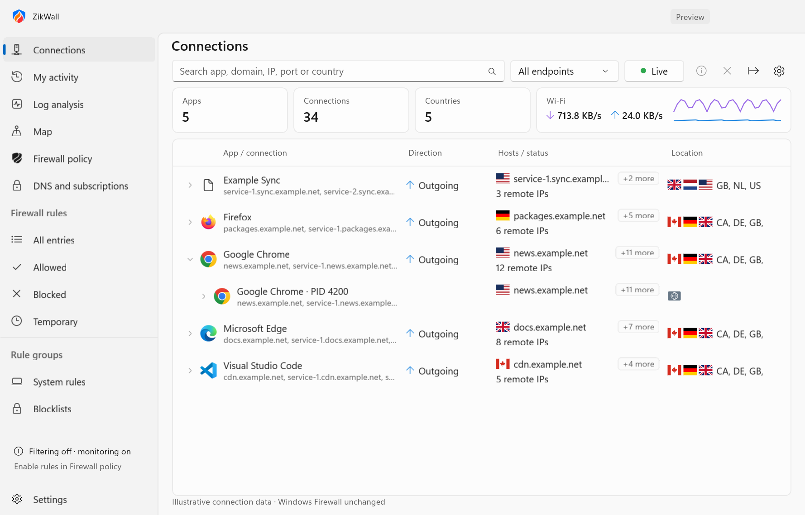

# ZikWall for Windows 11 — WinUI 3 preview


ZikWall is the new app name. The user-supplied blue Z shield is used in the title bar, executable, taskbar and tray. Source folders and namespaces use ZikWall; upstream copyrights and compatible profile formats are preserved. Attribution is recorded in [the upstream notices](../docs/UPSTREAM-NOTICES.md). See the [Little Snitch comparison](../docs/LITTLE-SNITCH-COMPARISON.md) for the current feature gaps.

This is a compiled native Windows desktop UI built with **WinUI 3, Windows App SDK 1.8, and the Windows SDK**, in C# and XAML. It uses Mica, NavigationView, CommandBar, native search, ListView, ContentDialog, InfoBar, Fluent icons, system theme resources and Windows typography. It is not a web page or a reskinned Win32 control panel.

The screenshots below show the current native UI with illustrative connection data. See the [screenshot gallery and reproduction steps](../docs/screenshots/README.md).



[Dark theme screenshot](../docs/screenshots/connections-dark.png)

## Run

To build the current app with WinUI 3 setup and an MSI, run `build.bat` from the repository
root, then open `artifacts/installer/setup.exe`. Repeat after new changes for an
upgrade installer. See [installer details](../docs/INSTALLER.md).

For a portable development build:

On Windows with .NET SDK 8 or newer, Visual Studio C++/Windows build tooling and Windows SDK installed:

```powershell
.\tools\build-winui.ps1 -Launch
```

The self-contained x64 output is `artifacts\ZikWall\ZikWall.exe`. Keep its output folder together; copying only the executable is insufficient. The shell runs without administrator rights. Design target: Windows 11; package API minimum: Windows 10 build 19041. Only Windows 11 x64 was exercised here.

## Working features and boundaries

| Feature | State |
| --- | --- |
| Native Windows 11 navigation, Mica, light/dark/system themes | Implemented |
| Rule list and selection inspector | Implemented; inspector collapses at narrow widths, Details remains accessible |
| Allowed, blocked, temporary, system and blocklist views | Implemented over the selected saved firewall profile; legacy XML inspection remains read-only |
| Search by app/path/address/protocol/comment | Implemented |
| Rule editor and time-limited permissions | Saved to the shared policy store; apply through the WFP broker with expiry enforcement |
| Open legacy XML profile | Implemented, read-only, bounded parser |
| Live connections and activity | Live TCP IPv4/IPv6 endpoints, UDP local endpoints, app logos, process/PID, TCP direction, offline country flags, Internet/direction filters, recent observation alerts, search, pause, CSV export and optional local history |
| Bandwidth chart | Per-adapter download/upload rates; not per-app accounting |
| Reverse DNS | On-demand lookup, explicitly a hint rather than proof of the app-requested hostname |
| Executable inspection | SHA-256 and offline Windows signature trust status; no signature-bound rules |
| DNS and subscriptions | Loopback UDP/TCP DoH proxy, domain blocking/exceptions, HTTPS lists with optional hash pins; see [setup and limits](../docs/DNS-SUBSCRIPTIONS.md) |
| Geographic map | Offline live country markers with app/IP/direction details; see [data provenance](../docs/MAP-DATA.md) |
| WFP session rules and policy profiles | Separate broker; scoped outbound IPv4 TCP enforcement, expiry and cleanup passed runtime tests; broader validation remains |
| Check saved rules | Read-only coverage, expiry, inactive-rule and executable-availability diagnostics; no automatic removal |
| Encrypted/compressed profile containers, internal overrides | Not supported by the reader |
| Full Little Snitch feature parity | Not claimed; per-app domain policy, per-app accounting, connection prompts and broader lifecycle validation remain |

Monitor options, host lists, usage history, connection/executable details, log details, saved-rule details, the rule editor and rule-check results open in separate resizable windows. Repeated clicks raise the existing window; tool windows follow the app theme and close when the app exits. These windows share the running monitor rather than starting additional collectors. Small menus and confirmation prompts remain inline.

The app opens on live Connections. **Firewall rules** shows the selected profile from **Firewall policy**, with no sample entries. Create, edit, disable, remove, and search saved rules here. **Enable filtering** applies the selected profile through the installed background service (portable builds request Windows elevation); after editing, **Apply saved policy** updates the active session. The banner and inspector distinguish saved/pending rules from applied rules. System and blocklist groups are saved with each rule; subscription IP imports use the Blocklists group. Rule order and profile selection are managed in Firewall policy. Session rules end when ZikWall closes; saved definitions survive restart. **Open profile** can inspect a plain XML `profile.xml` export or the repository's `bin\profile_internal.xml`. Disabled application blanket permissions are shown as Disabled, not falsely labeled explicit Block rules. Imported profiles cannot be edited. Unsupported profile formats produce an error without replacing the current data.

After opening a legacy XML profile, **Saved rules** returns to the working policy without changing it. Imported XML entries are never automatically enforced. Settings changes the UI theme for this session and supports current-user sign-in startup. All UI strings introduced here are currently English.

Current output is `artifacts\ZikWall\ZikWall.exe`, accompanied by the WFP broker, engine DLL, runtime and assets. Keep this folder together. [Current implementation status](../docs/FEATURE-STATUS.md) distinguishes tested features from the privileged runtime gate and remaining parity work. The screenshot gallery shows the current Connections, My activity, and Log analysis pages.

## Firewall integration

The public `henrypp/routine` HEAD is incompatible with the reviewed upstream source revision; this was reproduced in an unmodified baseline. The prior Win32 redesign experiment was removed when the requested design changed to Windows 11/WinUI. The production C project only retains the updater hardening changes; it does not pretend to host this WinUI shell.

The new [Windows SDK WFP broker](../docs/WFP-BROKER.md) avoids this dependency. It builds from public Windows SDK APIs, validates bounded rule messages and verifies peer process identity on a restricted local pipe. User-approved loopback tests passed for the native engine and the real unelevated client/elevated broker, including rejection of an invalid replacement, expiry and disconnect cleanup. The broker document lists the remaining validation gate and deployment boundary. Session filtering ends when the app/broker closes; it does not persist across reboot.

See `docs/SECURITY-REVIEW.md` for review scope, findings and mitigations.

## Checks

```powershell
dotnet run --project tests\WinUI.Models.Tests -c Release -- bin\profile_internal.xml
.\tools\test-supply-chain.ps1
```

The test executable directly compiles production models and services; it needs no test-framework package. All 160 checks passed on 12 October 2026. The separate broker diagnostic passed 15 scoped runtime checks through UAC. Earlier UI inspection covered native navigation, selection, preview rule creation, responsive layout, light/dark themes and caption contrast; the newer pages still need fresh visual QA.

The monitor defaults to a five-second low-resource refresh, with two-/ten-second choices and slower 15-second background/minimized sampling. Native connection rows update incrementally without transition animations; hidden views avoid redraws. [Performance measurements, limits and repeatable benchmarks](../docs/PERFORMANCE.md) document the resource budgets and test scope.

The project and namespaces now use ZikWall. Current screenshots use illustrative data; see the validation reports for tested behavior.

To regenerate the logo assets, run `python tools/generate-brand-assets.py` with Pillow installed. The user-supplied master is preserved in `tools/branding/ZikWall-source.png`; conversion retains its artwork and transparency. The committed PNG and nine-size ICO (16–256 px), including native resource icons, require no Python dependency at app build or runtime.

The monitor puts connection rows first, with a live summary (apps, connections, countries, adapter rate and a short sparkline), a Live/Paused toggle and a dot on newly seen connections. Secondary controls and the full adapter chart are under the **Options** (gear) button. The map stacks its country panel below the map in tall windows; select a dot or a country to list its apps and IPs. In-app recent alerts default on; Windows notifications are opt-in there. [Direction, country-data provenance, notification behavior and limitations](../docs/MONITORING.md) describe exactly what is observed. Native icon loading, all flag decodes, notification registration/submission and a fresh XAML render passed; the compositor/chrome and desktop-toast appearance are outside that render check.

## Expandable monitor, tray and usage

See [monitor and usage behavior](../docs/MONITOR-AND-USAGE.md) for grouping, offline country markers, 30-day observed traffic, current-user sign-in startup, and the collector validation limitation. Run `ZikWall.exe --enable-startup` once to register the current output path for sign-in. Normal launch restores the existing instance. X hides; tray Exit quits.

Run `ZikWall.exe --test-rules` for the native rule-browser diagnostic. It uses an isolated policy directory in the build output, exercises list synchronization, filters, search, editor cancellation, saving/reloading edits and removal, writes `rules-selftest.txt` and `rules-preview.png`, and leaves filtering off.
